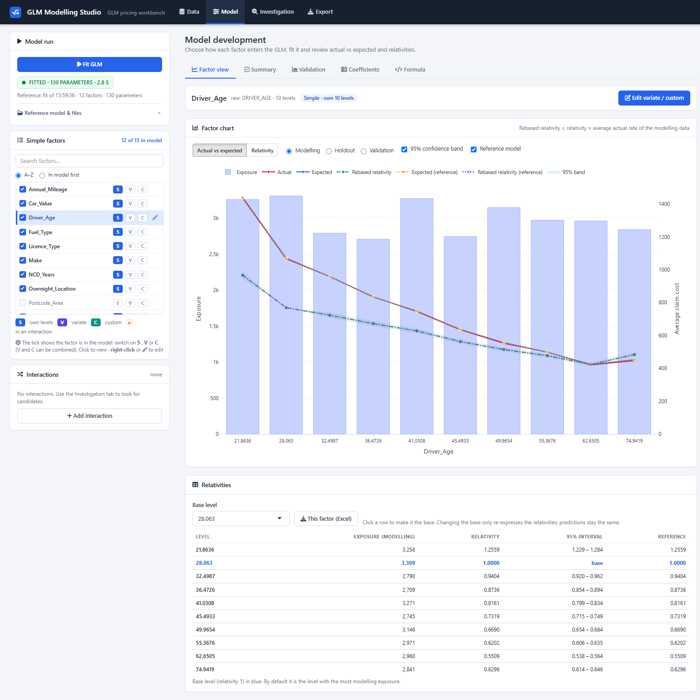

# GLM Modelling Studio

**A point-and-click workbench for building, validating and exporting insurance pricing GLMs in R.**

GLM Modelling Studio is an R Shiny application that takes you from a raw policy-level dataset to a fitted,
validated generalised linear model and its relativity tables, without writing code. It covers the whole
pricing workflow: banding rating factors, choosing how each factor enters the model (own levels, fitted
curves or custom groupings), two-way interactions, validation on holdout data, and an Excel and HTML/PDF
export of the result.



## Features

| Area | What you can do |
|---|---|
| **Data** | Import `.rds`, `.csv` or `.parquet`; pick the response, exposure, optional offset and a modelling / holdout / validation partition; rename factors once and use the new names everywhere. |
| **Factor mapping** | Band numeric factors automatically (quantile bands), by hand, or with your own From / To bands; group categorical levels; preview the new banding before applying it; save and reload mapping sets (`.rds` or Excel). |
| **Model** | Poisson frequency, Gamma severity, Tweedie burning cost or Binomial (logit) models with a log or logit link. Each factor can use its own levels, a linear / quadratic / cubic **variate** over chosen values, a **custom** grouping, or variate and custom together. Add two-way interactions. |
| **Review** | Actual vs expected by level for every partition, rebased relativities with 95% confidence bands, editable base levels, and a reference model drawn alongside for comparison. |
| **Validation** | Gains curves with normalised Gini, lift charts, feature importance (Wald χ², relativity spread, or an exact drop-one deviance check), a side-by-side comparison with the reference model, and an automatic check that the relativity tables reproduce the model's predictions. |
| **Investigation** | Two-way actual vs expected charts to find interactions the model is missing. |
| **Export** | All relativities in one Excel workbook (one tab per factor and interaction); a full model report as interactive HTML or PDF. Fitted models and model definitions can be saved and reloaded. |

## Quick start

**Requirements:** R 4.4.1 ([download](https://cran.r-project.org/bin/windows/base/old/4.4.1/)) and an internet
connection for the first start. RStudio is optional.

1. Download this repository (**Code › Download ZIP**, then unzip) or clone it:
   ```bash
   git clone https://github.com/gongyingqiu/GLM-App.git
   ```
2. Start the app:
   - **Windows:** double-click `run_app.bat`.
   - **macOS / Linux:** `Rscript run_app.R /path/to/GLM-App`
3. The app opens in your web browser. Load `demo/motor_premiums.rds` on the **Data › Import** tab and follow
   the worked example in the [user guide](docs/user-guide.md).

The first start installs the exact package versions listed in `renv.lock` into a private library, which takes
a few minutes. Your own R library is not used or changed, and later starts are immediate.

Already have the packages? Then `shiny::runApp("path/to/GLM-App")` works too.

## Documentation

- **[User guide](docs/user-guide.md)**: installation, a step-by-step worked example, a reference for every
  screen, and troubleshooting.

## Your data stays on your computer

The app runs locally in R on your own machine. Files you open are read by your R session and are not sent
anywhere. The repository contains no data other than the demonstration dataset in `demo/`.

## Repository contents

| Path | Contents |
|---|---|
| `app.R` | User interface and server logic |
| `functions.R` | Modelling, charting and export functions (sourced by `app.R`) |
| `run_app.bat`, `run_app.R` | Launcher that installs the pinned package versions and starts the app |
| `renv.lock` | Exact package versions the app is tested with |
| `demo/motor_premiums.rds` | Demonstration dataset (50,000 motor quotes) used in the user guide |
| `docs/` | User guide and screenshots |

## Licence

Copyright © 2026 Ying Gong. All rights reserved. The source code is published for viewing; see
[LICENSE](LICENSE) for the terms.
