# GLM Modelling Studio: user guide

This guide explains how to install GLM Modelling Studio, walks through a complete model on the
demonstration data, and then describes every screen in detail.

## Contents

1. [Concepts](#1-concepts)
2. [Installing and starting the app](#2-installing-and-starting-the-app)
3. [Preparing your data](#3-preparing-your-data)
4. [Worked example: a premium model in ten steps](#4-worked-example-a-premium-model-in-ten-steps)
5. [Screen reference](#5-screen-reference)
6. [Saving and reloading your work](#6-saving-and-reloading-your-work)
7. [Limits and performance](#7-limits-and-performance)
8. [Troubleshooting](#8-troubleshooting)

---

## 1. Concepts

### The model

The app fits a generalised linear model with a log link (logit for Binomial). Every prediction is a
product of multiplicative factors:

```
prediction = base × relativity(factor 1) × relativity(factor 2) × … × interaction relativities × exposure (× offset)
```

Each factor has a **base level** with relativity 1. By default it is the level with the most modelling
exposure; you can change it at any time without changing the predictions.

| Model type | Distribution, link | Typical response | Typical exposure / weight |
|---|---|---|---|
| Frequency | Poisson, log | claim count | years of exposure |
| Severity | Gamma, log | claim cost | claim count |
| Burning cost | Tweedie, log | claim cost | years of exposure |
| Binomial | Binomial, logit | 0 / 1 outcome (e.g. conversion) | count |

For the Gamma and Tweedie models the response is modelled as a rate (response ÷ exposure) with the
exposure as the weight, and predictions are multiplied back by the exposure.

### Partitions

The data is split into up to three partitions by a column you choose, coded:

| Code | Partition | Used for |
|---|---|---|
| 1 | Modelling | fitting the model |
| 2 | Holdout | checking the fit on unseen data while you build the model |
| 3 | Validation | a final, independent check |

Only partition 1 is used to fit. All charts let you switch between partitions.

### How a factor can enter the model

On the **Model** tab each factor has three switches:

| Switch | Meaning | Parameters |
|---|---|---|
| **S** (simple) | one relativity per level of the factor | levels − 1 |
| **V** (variate) | a smooth curve over a value you give each level (linear, quadratic or cubic) | 1 to 3 |
| **C** (custom) | levels combined into groups you define, one relativity per group | groups − 1 |

S cannot be combined with V or C. V and C can be used together: for example a linear trend over age plus a
separate adjustment for one group of ages.

---

## 2. Installing and starting the app

### Requirements

- **R 4.4.1.** Other 4.4.x versions should work; the package versions in `renv.lock` were tested on 4.4.1.
- **Internet access on the first start**, to download the packages (about 140, including dependencies).
- **Memory:** about 1 GB for the demonstration data. Large datasets need more; see
  [Limits and performance](#7-limits-and-performance).
- A modern web browser (Edge, Chrome or Firefox).

### Starting the app

| System | How |
|---|---|
| Windows | Double-click `run_app.bat`. It expects R at `C:\Program Files\R\R-4.4.1`; edit the path at the top of the file if R is installed elsewhere. |
| macOS / Linux | In a terminal: `Rscript run_app.R /path/to/GLM-App` |
| RStudio | Open `App.Rproj` and run `shiny::runApp()` (uses your own installed packages). |

The launcher installs the exact package versions from `renv.lock` into a private library
(`tools::R_user_dir("GLM_UI", "cache")`), so it never changes the packages you use for other work. The
first start takes several minutes; after that the app opens straight away. Keep the console window open
while you use the app; closing it stops the app.

---

## 3. Preparing your data

The app expects one table with one row per policy, quote or record (rows may also be pre-aggregated). It
needs:

| Column | Requirement |
|---|---|
| Response | Numeric. Claim count, cost, premium, or 0 / 1 for Binomial. Gamma needs a response above 0. |
| Exposure / weight | Numeric. Rows with zero or missing exposure are dropped when the structure is applied. |
| Partition | Values 1, 2 and / or 3 (see [Partitions](#partitions)). |
| Rating factors | Any numeric or categorical columns. Missing values become their own `NA` level, so no rows are lost. |
| Offset (optional) | A numeric prior expectation; the model then fits relativities on top of it. |

Supported formats: R data (`.rds`), CSV / text (`.csv`, `.txt`, with a choice of separator), and Parquet
(`.parquet`). Parquet loads fastest; `.rds` keeps factor level orders.

**Tip:** remove columns you will never use before importing. It makes every step faster and lighter on
memory.

---

## 4. Worked example: a premium model in ten steps

This example uses `demo/motor_premiums.rds`: 50,000 motor insurance quotes with the quoted premium, the
rating factors and a `SAMPLE` column (1 / 2 / 3) that splits the data 30,000 / 10,000 / 10,000. We fit a
Gamma model of the premium, which is the usual way to study how a price varies with rating factors.

### Step 1: import the data

On **Data › 1 Import**, choose **R data (.rds)**, click **Browse…** and pick `demo/motor_premiums.rds`.
The preview and a summary of every column appear.

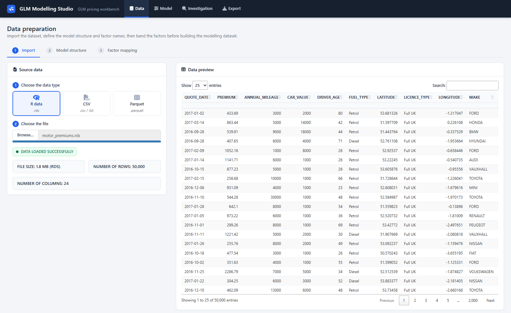

### Step 2: define the model structure

Open **Data › 2 Model structure** and set:

| Setting | Value |
|---|---|
| Model type | Severity · Gamma, log link |
| Response | `PREMIUM` |
| Exposure / weight | `policy_count` |
| Offset | NONE |
| Partition factor | `SAMPLE` |

In **Rating factors**, Ctrl + click the factors to model. The example uses 15: annual mileage, car value,
driver age, fuel type, licence type, make, NCD years, overnight location, postcode area, prior claims,
vehicle age, vehicle category, vehicle usage, years licence held and years owned.

In **Factor names**, give the factors readable model names (for example `DRIVER_AGE` → `Driver_Age`). You
can also paste a whole column of names from Excel. From here on the app uses the model names everywhere:
in charts, formulas, exports and saved files.

Click **Apply model structure**. The status line confirms the split: *Modelling 30,000 · Holdout 10,000 ·
Validation 10,000*.

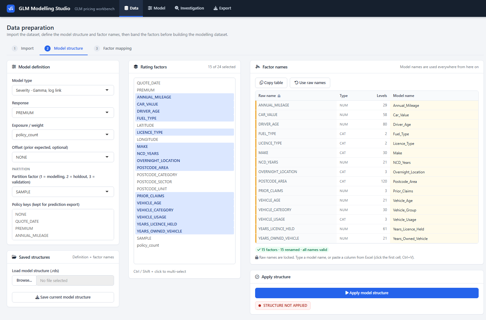

### Step 3: band the factors

Open **Data › 3 Factor mapping**. Click a factor to see its exposure (bars) and average response (line).
`Driver_Age` has 80 single-year levels, too many to model directly.

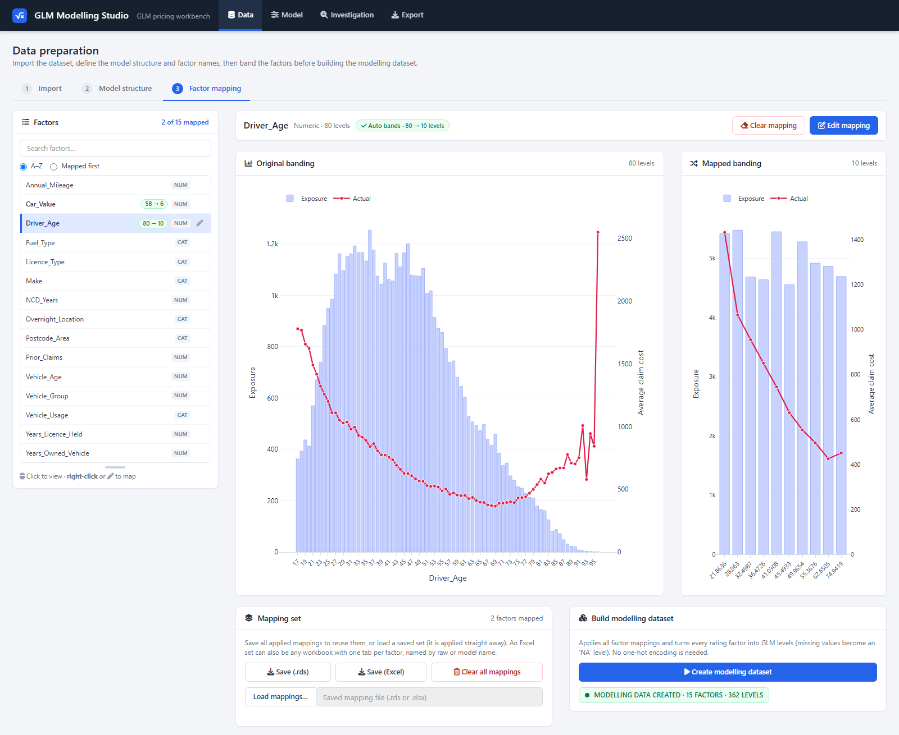

Click the pen icon (or right-click the factor) to open the mapping window. Choose **Auto banding**, keep
10 bands, click **Create bands**, then **View new banding** to compare the original and new levels. Click
**Apply mapping**.

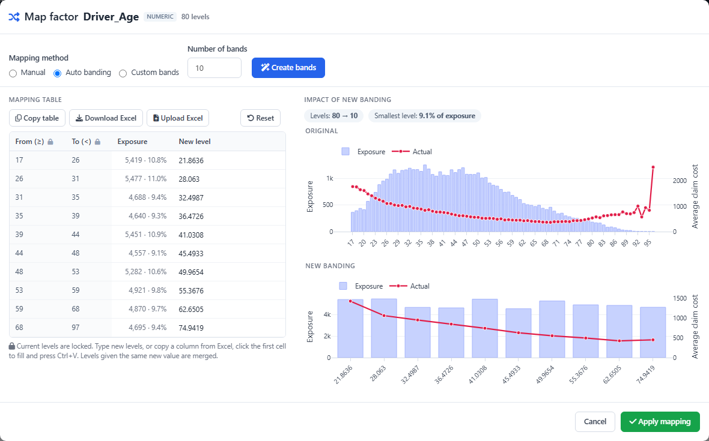

The example also bands `Car_Value` the same way. Use **Save (.rds)** or **Save (Excel)** under
**Mapping set** to keep the bandings for next time.

### Step 4: create the modelling dataset

Click **Create modelling dataset**. The app applies every mapping and turns each factor into GLM levels.
The status shows *15 factors · 362 levels*.

### Step 5: choose the model terms and fit

Open the **Model** tab. In **Simple factors**, switch on **S** for the factors to include and **V** for
`Vehicle_Age` (a fitted curve over vehicle age). The tick on the left shows that a factor is in the model.

Click **Fit GLM**. A summary of the fit appears: here 130 parameters, 61.0% of the deviance explained, a
holdout Gini of 79.5% and a holdout actual ÷ expected of 0.995.

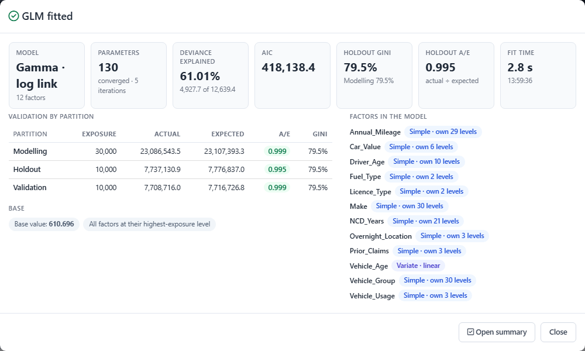

### Step 6: review each factor

Close the summary and click a factor in the list. The **Factor view** shows, for the chosen partition:

- **bars**: exposure by level;
- **Actual** (red) and **Expected** (blue): average response by level. They should track each other;
- **Rebased relativity** (green): the model's relativity × the average response, with its 95% confidence
  band. This is the factor's own effect once the other factors are allowed for;
- the **reference model's** lines (dotted), when a reference model is set (step 8).

The **Relativities** table below lists each level's exposure, relativity and 95% interval. Click a row, or
use **Base level**, to make another level the base; the predictions do not change.

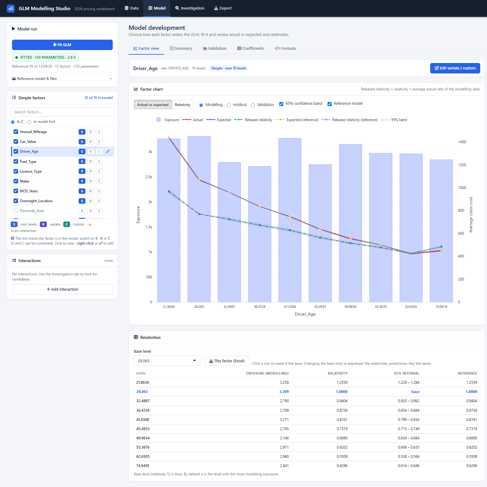

### Step 7: refine a factor with a variate or custom groups

Click the pen icon next to a factor to open its editor.

- **Variate:** give each level a value (by default the level itself) and choose a linear, quadratic or cubic
  curve. The chart shows the one-way fit; **Preview in full model** refits the whole model with your
  settings so you can see the real relativity before committing.
- **Custom:** assign levels to groups (type in the table or paste from Excel). **One group per level** and
  **All to 'Other'** are quick starting points.

The example switches `Vehicle_Age` to a **cubic** variate, which follows the shape of the data much better
than a straight line. Click **Apply**, then **Fit GLM** again.

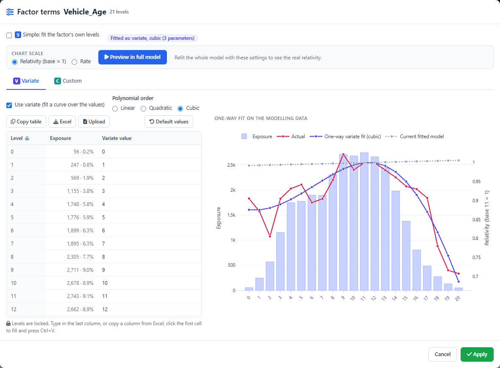

### Step 8: set a reference and add an interaction

Under **Reference model & files**, click **Set current** to keep the current fit as the reference. Every
later fit is compared with it.

The **Investigation** tab helps find interactions: choose a factor for the x-axis and one to split by. If
the gap between the actual (solid) and expected (dashed) lines differs between colours, the first factor's
effect depends on the second.

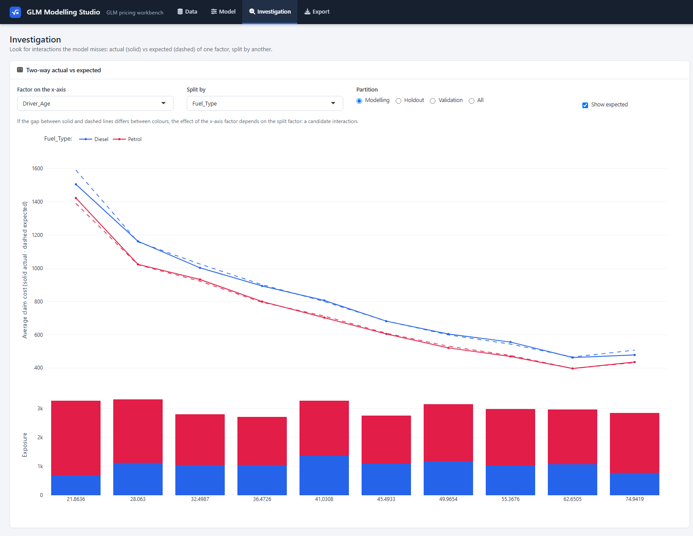

To add one, click **Add interaction** on the Model tab, choose the two factors and how each is used (own
levels, variate values or custom groups), then click **Add** and refit. The example adds
`Driver_Age × Vehicle_Usage`.

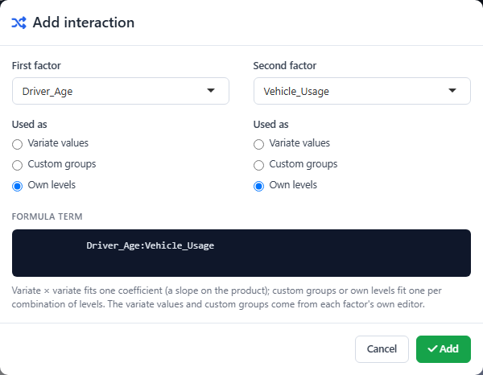

Click the interaction in the **Interactions** list to see it. **Actual vs rebased** draws one line per
level of the second factor; the **x-axis** buttons swap which factor is on the x-axis. **Interaction only**
and **Heatmap** show just the interaction's own effect.

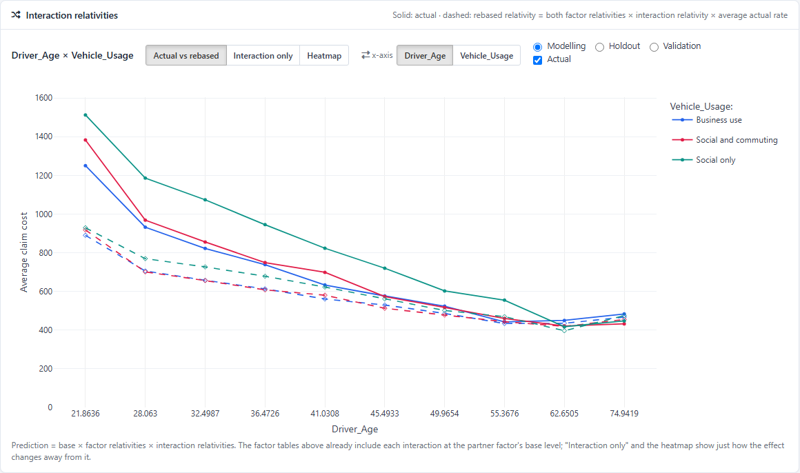

### Step 9: validate

Open the **Validation** tab.

- **Gains curve & Gini:** how well the model ranks risks, by partition. The dotted lines are the
  reference model.
- **Lift chart:** actual and expected by band of predicted value, on the partition you choose.

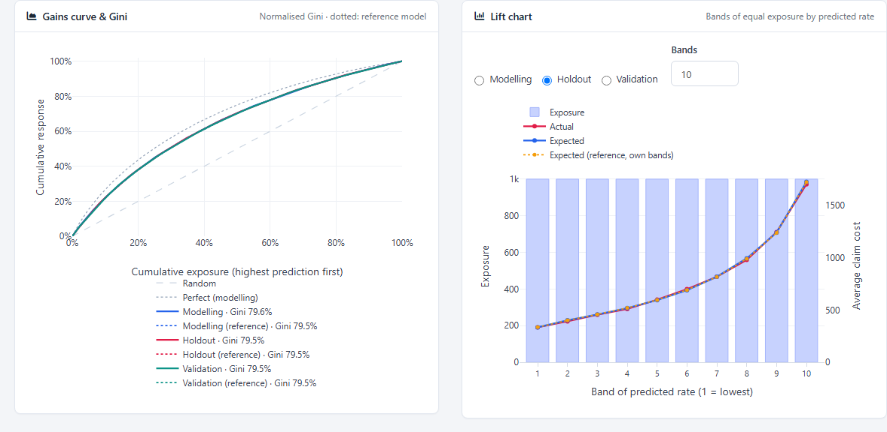

- **Feature importance:** each term's share of the Wald χ², or its relativity spread. For a definitive
  ranking click **Run drop-one check**, which refits the model without each term in turn and measures the
  increase in deviance.

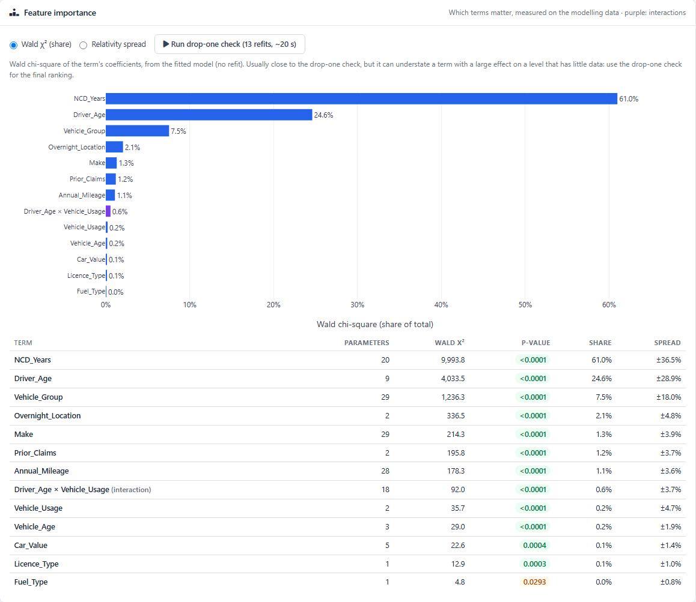

- **Model comparison:** the current fit against the reference: A/E and Gini by partition, parameters,
  deviance and AIC, and which terms were added, removed or changed. Here the interaction adds 20 parameters
  and improves the holdout Gini by 0.07 points.

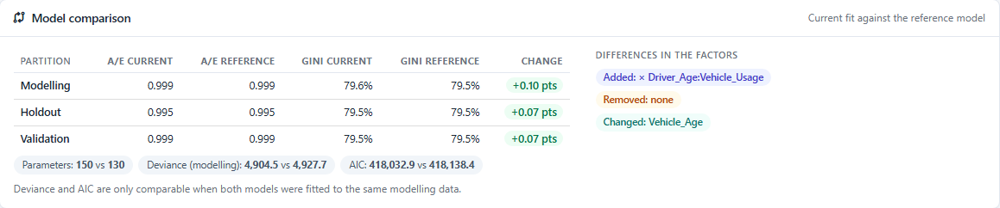

- **Relativity check:** confirms that base × relativities, as exported, reproduces the model's predictions
  for every row.

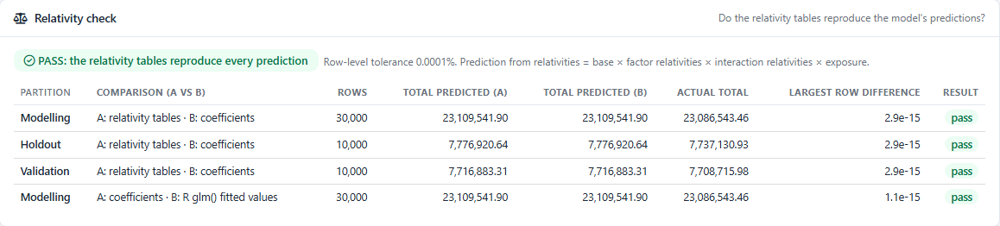

### Step 10: export

On the **Export** tab:

- **Download all relativities (Excel):** one tab per factor and per interaction, plus a *Base* tab and an
  *Index* tab listing the full names (Excel shortens tab names to 31 characters).
- **Create report:** a complete model report as interactive **HTML** or **PDF**, for the partitions and
  factors you choose. It contains the fit summary, feature importance, gains and lift charts, a relativity
  chart and table plus actual vs expected for every factor, every interaction, and the coefficients.

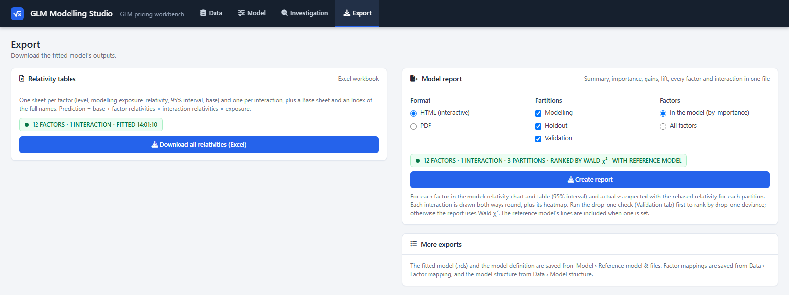

Save the fitted model and its definition under **Model › Reference model & files** so you can reload them
later (see [section 6](#6-saving-and-reloading-your-work)).

---

## 5. Screen reference

### Data tab

| Sub-tab | Controls |
|---|---|
| **1 Import** | Data type (`.rds`, `.csv` / `.txt` with separator and header options, `.parquet`), file choice, file size, rows and columns, data preview, column summary. |
| **2 Model structure** | Model type, response, exposure, offset, partition column, policy keys; the rating factor list; the **Factor names** table (copy to Excel, paste names, reset to raw names; invalid or duplicate names are marked in red); **Apply model structure**; save / load the structure. |
| **3 Factor mapping** | Factor list with search and sort; one-way chart of the factor; the mapping window (**Manual**, **Auto banding**, **Custom bands** with From / To edges, overlap and gap checks, and 3-column paste from Excel); mapping set save / load / clear; **Create modelling dataset**. |

### Model tab

| Part | Contents |
|---|---|
| **Model run** | **Fit GLM**; Tweedie power (Tweedie models only); reference model (**Set current**, **Clear**, **Load…**); save the fitted model; save / load the model definition. |
| **Simple factors** | The S / V / C switches for every factor; click to view, pen or right-click to edit. A × badge marks factors used in an interaction. |
| **Interactions** | List of two-way interactions; click to view, × to remove; **Add interaction**. |
| **Factor view** | Actual vs expected or relativity chart, partition choice, confidence band and reference toggles; relativity table with base-level choice and **This factor (Excel)** download; interaction charts. |
| **Summary** | The fit summary: model, parameters, deviance explained, AIC, Gini and A/E by partition, base value, and how each factor is fitted. |
| **Validation** | Gains & Gini, lift chart, feature importance with drop-one check, model comparison, relativity check. |
| **Coefficients** | Every coefficient with standard error, test statistic and p-value. |
| **Formula** | The model formula built from your choices, and **Import a formula**: paste a right-hand side such as `Age_var + I(Age_var^2) + Region_custom + Fuel` (`_var` = variate, `_custom` = custom groups, plain name = own levels, `a:b` = interaction) to set all the switches at once. |

### Investigation tab

Two-way actual vs expected: a factor on the x-axis, split by a second factor (up to 30 levels), on any
partition or all data, with the model's expected values shown dashed.

### Export tab

Relativity workbook (Excel) and model report (HTML or PDF). See [step 10](#step-10-export).

---

## 6. Saving and reloading your work

| What | Where to save | Contains | Reload with |
|---|---|---|---|
| Model structure | Data › Model structure › **Save current model structure** | model type, response, exposure, offset, partition, factors and their model names | **Load model structure (.rds)** on the same screen |
| Mapping set | Data › Factor mapping › **Save (.rds)** / **Save (Excel)** | all applied bandings and groupings | **Load mappings…** (an Excel workbook with one tab per factor, named by raw or model name, also works) |
| Model definition | Model › Reference model & files › **Save definition (.rds)** | S / V / C choices, variate values and orders, custom groups, interactions | **Load…** under *Model definition* |
| Fitted model | Model › Reference model & files › **Save fitted model (.rds)** | the fitted model, for comparison | **Load…** under *Reference model* |
| Relativities | Export › **Download all relativities (Excel)** | relativity tables | (output only) |
| Report | Export › **Create report** | HTML or PDF report | (output only) |

A typical return visit: import the data, load the model structure, load the mapping set, create the
modelling dataset, load the model definition, and fit.

---

## 7. Limits and performance

| Item | Limit |
|---|---|
| Parameters in one model | 1,500 (the app checks the size and memory before fitting) |
| Levels shown in a one-way chart | 500 (a message is shown instead above this) |
| Levels in a hand-editable mapping or editor table | 3,000 |
| Levels of the split factor in two-way charts | 30 |
| Interactions | two-way only |

Memory use grows with rows × columns and, during the fit, rows × parameters. As a guide, a dataset of
about 630,000 rows and 114 columns peaked at about 3.7 GB of RAM while fitting. Drop unused columns, and
band factors with many levels, to keep models fast.

---

## 8. Troubleshooting

| Problem | What to do |
|---|---|
| `run_app.bat` says R 4.4.1 was not found | Install R 4.4.1, or edit the `RSCRIPT=` line at the top of `run_app.bat` to point at your `Rscript.exe`. |
| The first start fails while installing packages | Check the internet connection (the packages come from `packagemanager.posit.co`; one comes from GitHub). Corporate networks may need these sites allowed. |
| A pop-up says the model cannot be fitted | Read the hints in the pop-up. Common causes: a Gamma response of zero or below, a factor with only one level in the modelling data, or too many parameters. |
| A factor's relativities look unstable | Check its exposure bars: band sparse levels together, or use a variate or custom groups. |
| A loaded mapping or definition is partly skipped | The pop-up lists what was skipped. The file probably came from a dataset with different factor names or levels. |
| The app stops responding | Look at the console window for an error message. Closing and restarting the app is safe; save your structure, mappings and definition as you go. |
